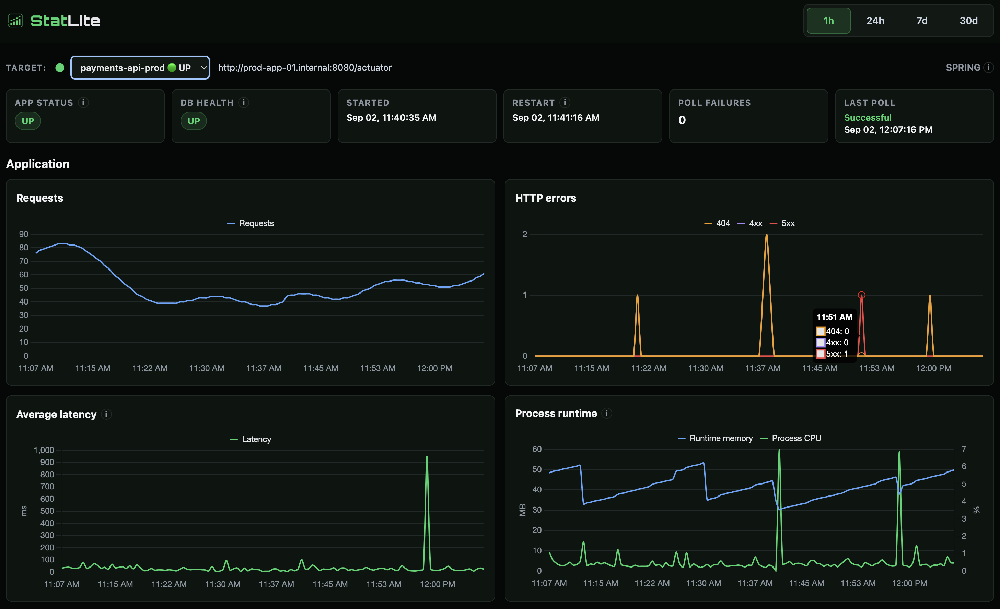
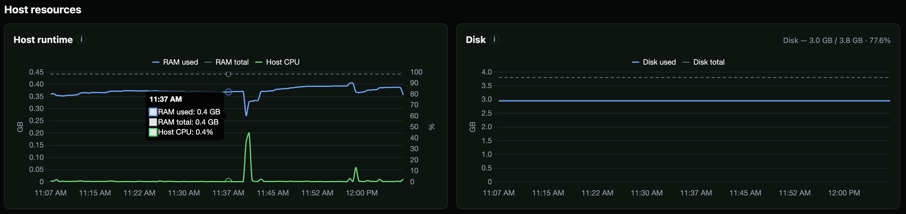

<h1>
  
  StatLite
</h1>

[](https://github.com/PVRLabs/statlite/releases)
[](https://github.com/PVRLabs/statlite/actions/workflows/test.yml)
[](LICENSE)
[](docs/integrations.md)
[](go.mod)

StatLite provides lightweight, self-hosted application monitoring for apps running
on VPSs and small servers. One Go binary polls multiple applications, stores
metrics locally in SQLite, and provides built-in historical
charts, without requiring Prometheus or Grafana.

🌐 [Website](https://pvrlabs.xyz/statlite) · 👀 [Interactive demo](https://pvrlabs.xyz/statlite/demo.html)

<p align="center">
  
  <br><sub>Main application dashboard for the Spring target.</sub>
</p>

StatLite supports Spring Boot, Quarkus, and Micronaut integrations, and other
applications through [a small, fixed JSON metrics endpoint](docs/statlite-metrics-v1.md).
It collects traffic, latency, CPU, memory, optional application health, and
optional host metrics. Metrics and history stay on your server, without
continuously sending application metrics to a third-party monitoring SaaS.

StatLite is built for [resource-constrained servers](docs/low-resource-monitoring.md).
Low memory, CPU, disk, and operational overhead are treated as product
constraints.

<p align="center">
  
  <br><sub>Host resources from the StatLite self-monitoring target.</sub>
</p>

Learn how to set up [lightweight Spring Boot monitoring without Prometheus and Grafana](https://pvrlabs.xyz/articles/lightweight-spring-boot-monitoring.html).

StatLite focuses on predefined application and host metrics with built-in
charts. See [monitoring options](docs/monitoring-options.md) for capabilities,
limitations, and tradeoffs.

## Install

Install the latest release on macOS or Linux:

```bash
curl -fsSL https://raw.githubusercontent.com/PVRLabs/statlite/main/install.sh | sh
```

Or install with Homebrew:

```bash
brew install pvrlabs/tap/statlite
```

On Windows 10 or later (x64), download the Windows zip from
[GitHub Releases](https://github.com/PVRLabs/statlite/releases/latest), extract
it, and run `.\statlite.exe` in PowerShell. The zip includes a ready-to-use
self-monitoring configuration. See [Windows](docs/windows.md) for details.

See [Installation](docs/install.md) for supported platforms, custom install
locations, source builds, and server-wide Linux setup.

## Try it

**Using Spring Boot?** Follow the [Spring Boot quickstart](docs/quickstart-spring.md)
to monitor your application locally using Actuator.

Start StatLite:

```bash
statlite
```

Open <http://127.0.0.1:9090>. StatLite [monitors itself by default](docs/configuration.md#statlite-self-monitoring),
so the dashboard starts with live data.

## Docker

Run StatLite using the official Docker image (`linux/amd64` and `linux/arm64`):

```bash
docker run --rm \
  -p 127.0.0.1:9090:9090 \
  docker.io/pvrlabs/statlite:latest
```

Open <http://127.0.0.1:9090>.

See the [Docker guide](docs/docker.md) for monitoring applications, persistent
storage, and networking.

## Configure an application

For a running Spring Boot application:

```bash
statlite inspect 'http://localhost:8080' --create-config ./statlite.yaml
statlite
```

Open <http://127.0.0.1:9090> to view the dashboard.

For other frameworks, existing configurations, and manual setup, see
[Configuration](docs/configuration.md) and
[Supported integrations](docs/integrations.md).

> [!IMPORTANT]
> StatLite has no built-in dashboard or API authentication. Review the
> [server and access guidance](docs/configuration.md#server) before exposing it
> remotely.

For applications behind Caddy, configure [native Caddy HTTP monitoring](docs/targets/caddy.md)
with an exact metrics URL and host. It observes HTTP traffic without application
instrumentation.

## Supported metric sources

StatLite collects application health, traffic, latency, CPU, and memory metrics,
depending on the integration.

- **[Spring Boot](docs/targets/spring.md):** Actuator health, request metrics,
  JVM heap, process CPU, and optional host metrics. Supports Micrometer
  Prometheus and Actuator JSON.
- **[Quarkus](docs/targets/quarkus.md):** Request, latency, CPU, JVM heap, and
  process metrics through Micrometer Prometheus/OpenMetrics. Optional SmallRye
  Health.
- **[Micronaut](docs/targets/micronaut.md):** Request, latency, CPU, JVM heap,
  and process metrics through Micrometer Prometheus. Optional management health.
- **[StatLite Metrics v1](docs/statlite-metrics-v1.md):** A small JSON endpoint
  for applications in any language. [Integration guides](docs/integrate/) cover
  FastAPI, Express, Django, Go `net/http`, and Gin.

StatLite and its integration helpers send no telemetry to external collection
services. StatLite polls your configured endpoints, and metrics remain under
your control.

See [Supported integrations](docs/integrations.md) for details.

## Documentation

- [Installation](docs/install.md)
- [Configuration](docs/configuration.md)
- [Supported integrations](docs/integrations.md)
- [Application integration guides](docs/integrate/)
- [External API v1](docs/api.md)
- [Documentation index](docs/README.md)

## License

MIT
