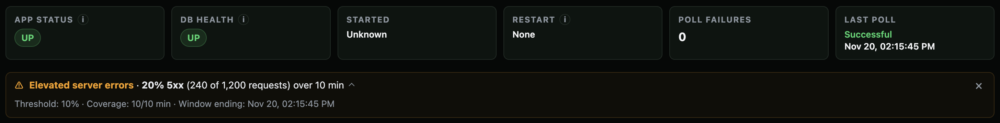

# Attention

An application can report **UP** while many of its requests return HTTP 5xx
errors. Starting in StatLite v0.8.0, an amber Attention strip appears below
the status cards when the error rate is elevated. The strip flags degraded
request handling while the App status card continues to show the application's
reported health.



## How StatLite detects elevated errors

StatLite compares increases in the total HTTP request and HTTP 5xx counters
from matching polls within a rolling 10-minute window. It divides the sum of
the 5xx increases by the sum of the request increases over those same intervals.

Attention is enabled automatically for supported targets. The built-in check
shows a warning when all three thresholds are met:

- At least **10%** of requests returned HTTP 5xx.
- At least **100 requests** were counted.
- At least **10 requests** returned HTTP 5xx.

The check requires comparable counters and enough fresh observations. The
counts can cover only part of the window, particularly at slower polling
cadences. Polling intervals longer than five minutes are unsupported for
this check.

## Inspect or dismiss a warning

Select the warning message to see the applied threshold and how much of the
window the counts cover. Select **×** to dismiss it for the current page
session. A dismissed warning can reappear if StatLite confirms recovery and
the condition then recurs. Missing, stale, or low-volume data leaves the
dismissal in place.

## Configure Attention

Use the optional top-level `attention` block to set thresholds for all
targets. Each omitted field keeps its built-in value. The evaluation window
is fixed at 10 minutes.

```yaml
attention:
  error_rate_percent: 15
  min_requests: 200
  min_errors: 25
```

`error_rate_percent` accepts a percentage greater than 0 and up to 100.
The count thresholds accept positive integers.

The top-level `attention.enabled` setting controls Attention for all targets.

```yaml
attention:
  enabled: false
```

With Attention disabled, the dashboard omits the strip and skips Attention
requests. The internal `/api/attention` endpoint returns HTTP 404. An open
dashboard tab that receives a 404 hides the strip and retries Attention on
its normal refresh schedule.
Restart StatLite to apply the setting.
