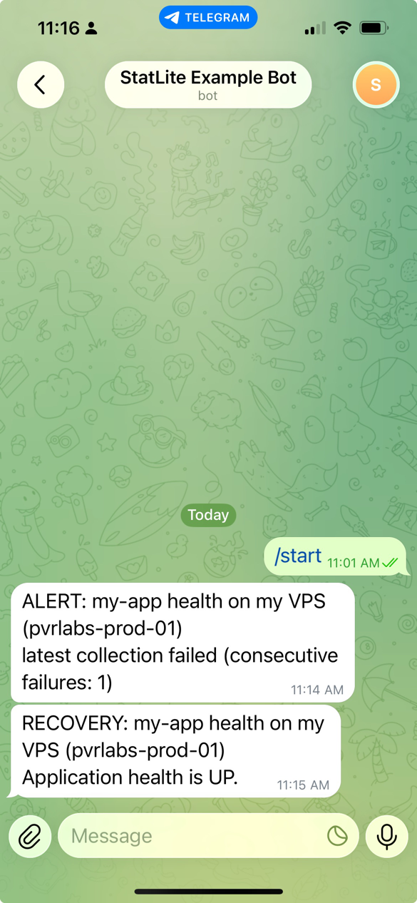

# Telegram application health alerts

Use StatLite's status API and a scheduled shell script to send Telegram alerts
and recovery messages. These six steps take you from creating your own bot to
verifying delivery and enabling automatic checks. The main path uses a private
chat; group chats are an optional variation below.

## Before you begin

Use a Linux host with `/bin/sh`, `curl`, `jq`, `flock` (usually util-linux),
`mktemp`, and cron or systemd. Keep the scripts from this directory together,
for example under `/opt/statlite/examples/api-automation`, readable and
executable by your scheduling user. Configure the application target in
StatLite first. The examples use an existing unprivileged user named
`statlite-alerts` with a home directory at `/home/statlite-alerts`.

If that account does not exist, ask your administrator to create it before
continuing. Run the configuration and launcher commands as `statlite-alerts`,
with `HOME=/home/statlite-alerts`. The systemd installation commands explicitly
require administrator privileges. Keep StatLite running and reachable from
this account throughout setup.

## 1. Create your bot

Open [@BotFather](https://t.me/BotFather) in Telegram Web or a Telegram app.
Send `/newbot`, then follow BotFather's prompts:

- Choose a display name, such as `My App Alerts`.
- Choose an available username ending in `bot`, such as `my_app_alerts_bot`.
- Save the token BotFather gives you privately. The token lets a program act
  as your bot; treat it as a password.

You create your own bot; there is no shared StatLite notification bot.
Success means BotFather confirms creation and supplies a link to your new bot
and its token. See Telegram's [bot setup guide](https://core.telegram.org/bots/features#botfather).

Before using the token from the terminal, create its protected configuration
as the scheduling user:

```sh
umask 077
mkdir -p "$HOME/.config/statlite-alerts" "$HOME/.local/state/statlite-alerts"
chmod 700 "$HOME/.config/statlite-alerts" "$HOME/.local/state/statlite-alerts"
touch "$HOME/.config/statlite-alerts/health.env"
chmod 600 "$HOME/.config/statlite-alerts/health.env"
```

Open `$HOME/.config/statlite-alerts/health.env` in an editor and save this
assignment, replacing the placeholder with your token:

```sh
TELEGRAM_BOT_TOKEN='replace-in-editor'
```

Do not paste the token into shell commands, shell history, logs, or repository
files. Do not enable shell tracing (`set -x`) or curl verbose logging. Rotate
the token through BotFather if it is exposed. This file is sourced as shell
code, so only its owner should be able to edit it.

## 2. Start a conversation with your bot

Follow the link BotFather supplied, or search Telegram for your new bot's
username. Open that bot, not BotFather, and send `/start` in the private chat.
This allows the bot to send you messages and makes your chat ID discoverable
through `getUpdates`. The bot won't reply to `/start`; it only sends
notifications through this recipe.

Success at this step is seeing your own `/start` message in the correct bot's
chat. No reply is expected. Leave that chat available to check the first alert.

## 3. Find your chat ID

The **bot token** identifies and authorizes your bot. The **chat ID** identifies
where it should send notifications. They are different values; do not put the
bot username or token in `TELEGRAM_CHAT_ID`.

As the scheduling user, run the following command to read recent messages
through Telegram's [getUpdates API](https://core.telegram.org/bots/api#getupdates).
It loads the token from the protected file and passes the token-bearing URL
to curl through stdin, keeping it out of process arguments. Output contains
chat IDs and types, not tokens.

```sh
set -a
. "$HOME/.config/statlite-alerts/health.env"
set +a
printf 'url = "https://api.telegram.org/bot%s/getUpdates"\n' "$TELEGRAM_BOT_TOKEN" |
  curl -q --config - --silent --fail --max-time 20 2>/dev/null |
  jq '.result[] | .message.chat? // empty | {id, type, title}'
```

For the private chat, expect a result shaped like this (the ID is illustrative):

```json
{"id": 123456789, "type": "private", "title": null}
```

A null title is normal for a private chat. Copy your own numeric `id` and add
this assignment to `health.env` using your editor:

```sh
TELEGRAM_CHAT_ID='replace-with-your-numeric-chat-id'
```

Success means you found a `private` chat entry and saved its ID alongside the
token. If several private chats appear, use a bot dedicated to this setup
and identify your conversation before choosing an ID.

If nothing appears, send a fresh `/start` to your bot and rerun the command.
Telegram keeps pending updates for no longer than 24 hours. Use a dedicated
bot with no webhook or other update consumer, otherwise updates may be
consumed elsewhere. If curl fails, check the saved token and network access;
never print the token to diagnose it.

## 4. Configure StatLite notifications

Keep the token and chat ID already saved in `health.env`. Append the remaining
settings below in your editor, adjusting them for your deployment:

```sh
BASE_URL='http://127.0.0.1:9090'
TARGET='my-app'
UNHEALTHY_VALUES='DOWN,OUT_OF_SERVICE'
MAX_POLL_AGE_SECONDS='180'
MAX_HEALTH_AGE_SECONDS='300'
SERVER_NAME='my VPS (pvrlabs-prod-01)'
CHECK_NAME="${TARGET} health on ${SERVER_NAME}"
STATE_FILE='/home/statlite-alerts/.local/state/statlite-alerts/my-app-health.state'
```

`BASE_URL` is your reachable StatLite address. `TARGET` must exactly match its
configured target name, and that target's integration must report application
health. Set `UNHEALTHY_VALUES` to the exact unhealthy values your integration
uses. Successful metrics collection alone does not satisfy this check.

`SERVER_NAME` is the display label you want in messages, such as
`my VPS (production-1)` or `production-1`. It need not match the operating
system hostname. `CHECK_NAME` combines it with `TARGET`; customize that
assignment for other conditions, such as CPU or HTTP errors.

Create `/home/statlite-alerts/check-health` with mode 700:

```sh
#!/bin/sh
set -eu
set -a
. /home/statlite-alerts/.config/statlite-alerts/health.env
set +a
exec /opt/statlite/examples/api-automation/notify-telegram.sh \
  /opt/statlite/examples/api-automation/check-status.sh
```

After saving the launcher, make it executable:

```sh
chmod 700 /home/statlite-alerts/check-health
/home/statlite-alerts/check-health
echo "Exit status: $?"
```

For a healthy target, expect exit status `0`, no Telegram message, and a state
file containing `healthy`:

```sh
cat "$HOME/.local/state/statlite-alerts/my-app-health.state"
```

That is a successful silent baseline, not proof of Telegram delivery. Exit
status `2` means the check could not be evaluated or the notifier failed;
read its diagnostic before proceeding. A target already unhealthy may send
an alert on this first run. Verify real delivery in the next step.

Keep the config and state directory private and persistent, and always use
the same scheduler user. Config, state and lock files use mode 600; private
directories use mode 700. Never delete a lock file while runs may be active.
Environment variables are also accepted, but are visible to sufficiently
privileged local processes.

## 5. Send your first notification

A successful first healthy check sends nothing, so it does not verify your
bot token, chat ID, or Telegram delivery. If you have a safe non-production
target, test a complete alert and recovery before scheduling. Do not
deliberately disrupt a production application to test notifications.

If you have no safe test target, this step is optional. Check your bot, chat,
target and launcher settings, then continue to step 6. Delivery remains
unverified until a real alert arrives in Telegram; a successful healthy check
does not validate the bot token or chat ID.

1. With the test target healthy, run the launcher as `statlite-alerts`:
   `/home/statlite-alerts/check-health`. This establishes the silent baseline.
2. Temporarily make the test target report a known unhealthy value configured
   in `UNHEALTHY_VALUES`, or stop its test metrics endpoint to cause a
   collection failure. Wait for StatLite's next poll and confirm that its
   status API reflects the failure, then run the launcher again.
3. Confirm an ALERT appears in your Telegram chat with the expected label and
   reason. Run the launcher once more while the condition is unchanged; it
   should not send another alert.
4. Restore the test target to health. Wait for a successful StatLite poll that
   reports healthy application status, run the launcher, and confirm RECOVERY
   appears in Telegram.

If you perform this test and either message is missing, check the launcher's exit status and diagnostics
and recheck the protected bot and chat settings before enabling a scheduler.
A healthy baseline alone is not evidence of delivery.

The text below illustrates an application-reported DOWN condition; the
screenshot shows a collection failure instead.

```text
ALERT: my-app health on my VPS (pvrlabs-prod-01)
Application health is DOWN.

RECOVERY: my-app health on my VPS (pvrlabs-prod-01)
Application health is UP.
```



Example collection-failure alert followed by recovery, captured during a
controlled test. Screenshot cropped for space. The server label is
illustrative. Create your own bot;
StatLite Example Bot is the bot used for this example.

## 6. Enable automatic checks

Choose one scheduler. In the `statlite-alerts` user's crontab (`crontab -e`):

```cron
PATH=/usr/local/bin:/usr/bin:/bin
* * * * * /home/statlite-alerts/check-health
```

Cron error output needs a configured local mail/log destination. For systemd,
install `/etc/systemd/system/statlite-health-alert.service`:

```ini
[Unit]
Description=Check application health and notify Telegram
After=network-online.target
Wants=network-online.target

[Service]
Type=oneshot
User=statlite-alerts
Environment=PATH=/usr/local/bin:/usr/bin:/bin
ExecStart=/home/statlite-alerts/check-health
UMask=0077
```

And `/etc/systemd/system/statlite-health-alert.timer`:

```ini
[Unit]
Description=Check application health every minute

[Timer]
OnBootSec=1min
OnUnitInactiveSec=1min

[Install]
WantedBy=timers.target
```

Enable the timer as an administrator:

```sh
sudo systemctl daemon-reload
sudo systemctl enable --now statlite-health-alert.timer
sudo journalctl -u statlite-health-alert.service
```

For cron, success means the command runs periodically and its output has a
working mail or log destination. For systemd, inspect the next scheduled run
and the most recent service result:

```sh
sudo systemctl list-timers statlite-health-alert.timer
sudo systemctl show statlite-health-alert.service -p Result -p ExecMainStatus
```

After a completed successful run, expect `Result=success` and
`ExecMainStatus=0`. An unchanged healthy target sends no new message. The timer
waits at least one minute after a run finishes; systemd may coalesce timer
wakeups, so it is not an exact wall-clock minute schedule. Keep scheduler
errors visible so silent notification failures are noticed.

## Optional: send to a group chat

Instead of the private-chat path, add your own bot to a group and allow it to
send messages. A plain group without topics is simplest. Send
`/start@YourBotUsername` in that group, then run the same `getUpdates` command
from step 3. Choose the entry with your group's title and type `group` or
`supergroup`, and save its numeric ID in the protected config. Group IDs are
negative; preserve the minus sign.

Use a separate config, launcher and state file for the group destination,
then repeat the first-alert and recovery test in that group before scheduling.
Success means both messages appear in the intended group, not just your
private chat.

## Message behavior and troubleshooting

Unreported dependencies are omitted. When dependency health is available,
the summary includes it, for example `Dependency health is DOWN`.

`CHECK_NAME` identifies the application and server. The first line of check
stdout supplies the reason, with its `OK:` or `ALERT:` prefix removed. The
wrapper removes control characters and limits the detail to 1,000 characters
and the entire message to 4,000. Check stderr is never sent. Use trusted checks
whose stdout is a short, non-secret summary, not raw responses, stack traces,
or credentials. The supplied checks follow this convention. UNKNOWN output
is not sent to Telegram. Customize the label without including secrets.
Telegram delivery uses plain text
[sendMessage](https://core.telegram.org/bots/api#sendmessage).

The health check reads `GET /api/v1/status`: recent collection failure counts
as unhealthy, as do exact health values in `UNHEALTHY_VALUES`. Configure those
values for your integration. API errors, stale polls, and missing or stale
application health are UNKNOWN, which preserves the previous state and never
sends recovery. See [health check details](README.md#how-the-checks-handle-missing-data).

The wrapper exits 0 after a successful run (including unhealthy notification,
unchanged state, or skipped overlapping run), and 2 for UNKNOWN or notifier
failure. Review scheduler logs for these errors. Telegram rejection, HTTP
failure, or timeout leaves state unchanged so the next run retries if the
condition still differs from the saved state. No queue or outage history is
stored. An outage that ends before successful delivery may go unreported.

State replacement is atomic and `flock` serializes each check invocation.
There is no exactly-once delivery guarantee: if Telegram accepts a message
but its response is lost, or the process stops before saving state, a later
run can send a duplicate. A failed local state write after sending also needs
operator attention. Deleting state resets the baseline behavior.

## Other checks and limits

The helper can wrap any command with the same 0=healthy, 1=unhealthy,
2=UNKNOWN convention, including the existing HTTP 5xx and sustained CPU checks.
Every target/condition/chat combination needs its own `STATE_FILE` and useful
`CHECK_NAME`; sharing state can hide transitions. Use a separate protected
config and launcher for each scheduled check. Unexpected check exit codes are
also UNKNOWN. Dependencies and permissions must be configured before use.

If the monitoring host is offline, it cannot run checks or deliver Telegram
alerts. Use independent uptime monitoring when that failure must be detected.
This recipe only observes scheduled samples, so short outages between runs can
be missed. It does not add generic rules or independent uptime monitoring.
